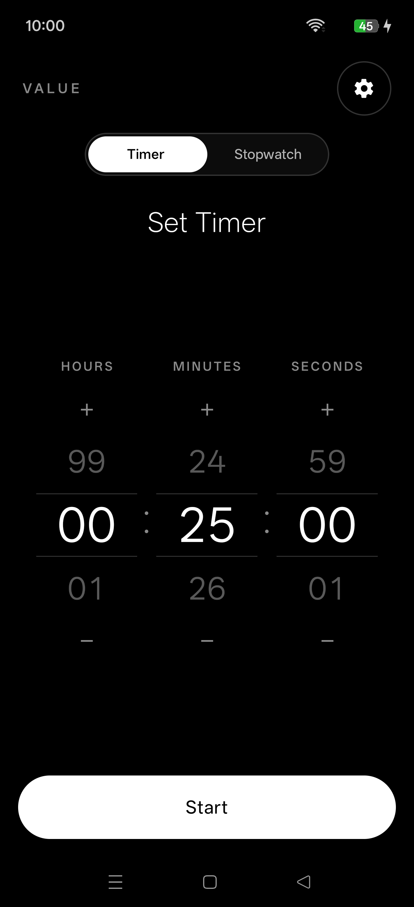
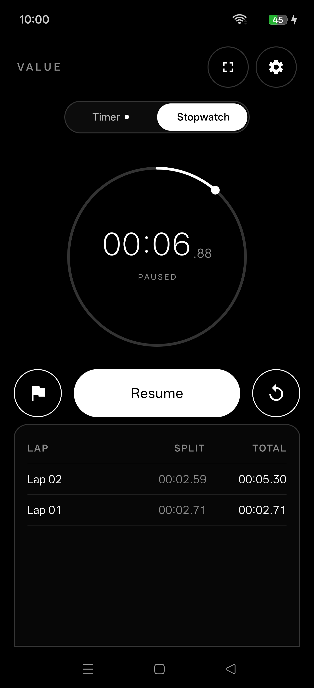
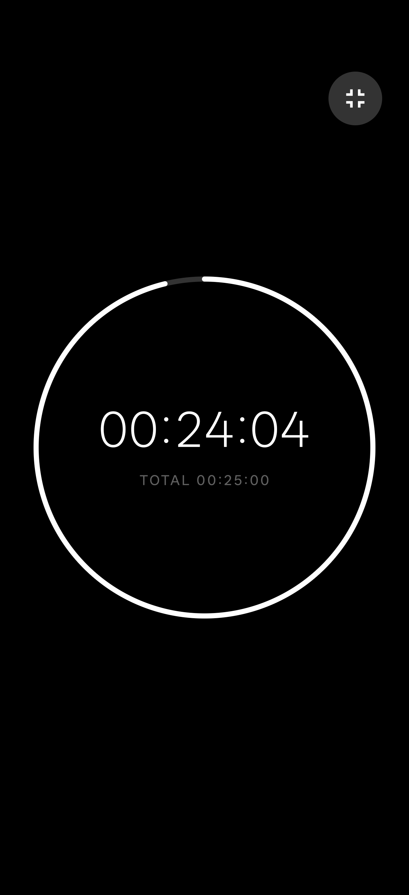
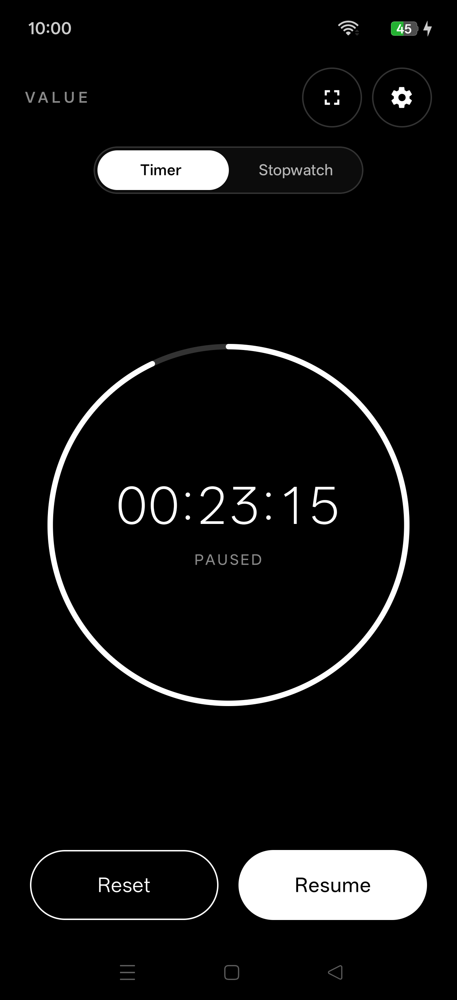
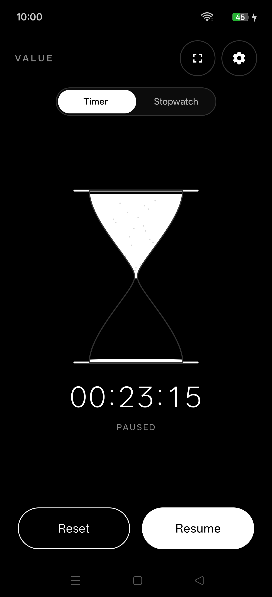
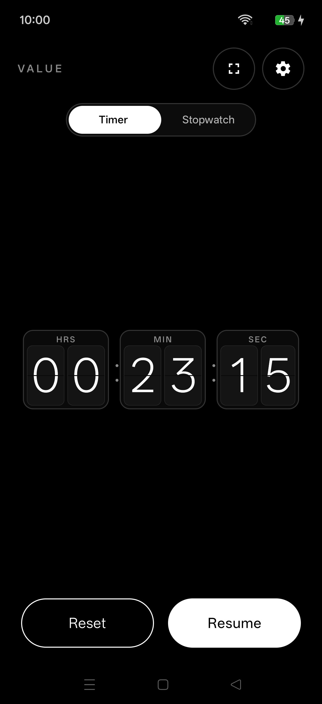
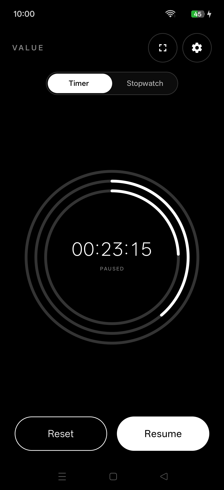
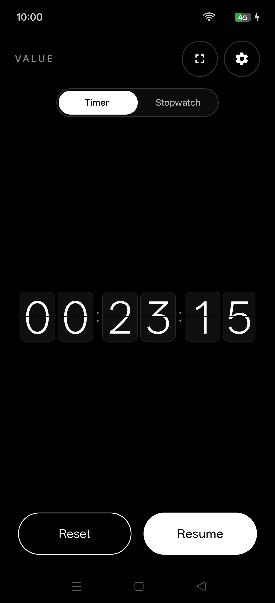
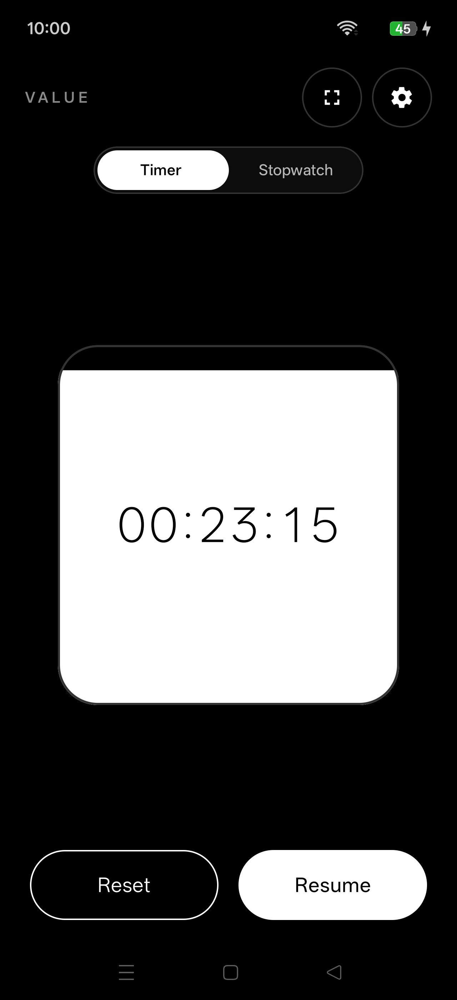
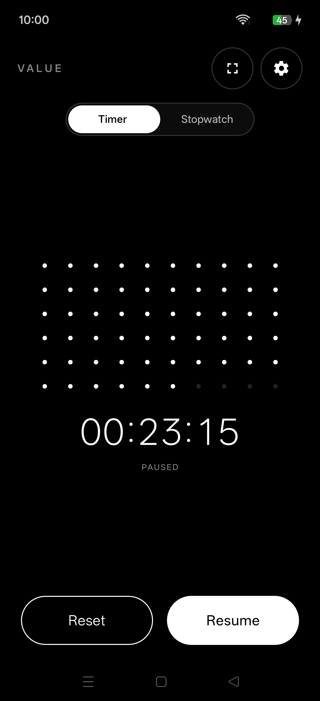

# VALUE

A minimalist timer and stopwatch for Android, in black and white only.

<table>
  <tr>
    <td align="center"><br />Set timer</td>
    <td align="center"><br />Running timer</td>
    <td align="center"><br />Stopwatch with laps</td>
    <td align="center"><br />Fullscreen view</td>
  </tr>
</table>

I wanted a clock app that shows time and nothing else. VALUE has no accent colors, shadows, or illustrations. Time is read through type and geometry alone.

## What it does

A countdown timer and a stopwatch with lap recording. Swipe or use the pill toggle to switch between them; a running session is not interrupted. Both run in foreground services with an ongoing notification, lockscreen controls, and an alarm when a timer finishes.

The fullscreen view hides its controls after a moment and pads around camera cutouts so the time stays centered in both orientations.

## Design decisions

The timer is set with three looping wheels (hours, minutes, seconds) that snap into place, so there is no keypad to deal with.

There are several themes, including Circle, Flip Clock and Three Box. They change how progress is drawn (arcs, flip cards, split flaps) but share the same timing engine, so a timer behaves the same whichever one you pick.

<table>
  <tr>
    <td align="center"><br />Circle</td>
    <td align="center"><br />Hourglass</td>
    <td align="center"><br />Three Box</td>
    <td align="center"><br />Concentric Rings</td>
    <td align="center"><br />Flip Clock</td>
    <td align="center"><br />Liquid Fill</td>
    <td align="center"><br />Dot Grid</td>
  </tr>
</table>

## Tech

Kotlin and Jetpack Compose, minSdk 26, targetSdk 35. Preferences are stored in DataStore. Timekeeping runs in foreground services backed by exact alarms, so timers stay accurate when the app is in the background.

## Build

Requires JDK 17 and Android SDK 35.

```bash
./gradlew testDebugUnitTest   # unit tests
./gradlew assembleDebug       # debug APK
./gradlew assembleRelease     # release APK (needs a signing config)
```

The APK is written to `app/build/outputs/apk/`.